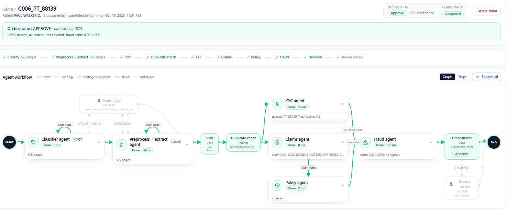

# MediShield Intake

A multi-agent system that reads a medical insurance claim, made of several scanned documents,
and returns one decision: **APPROVE**, **REJECT** or **ESCALATE**. It checks blur and identity,
extracts the claim, checks coverage against the policy and scores fraud. Escalated claims wait
for a human reviewer (human in the loop) and continue from where they stopped.

```
backend/           FastAPI + LangGraph + MySQL + Qdrant     (uvicorn, port 8000)
frontend/          Next.js 15 / React 19 / Tailwind UI      (port 3000)
database/          MySQL schema scripts (run once before the first start)
agents/notebook/   original research notebooks (reference only, not used at runtime)
```

---

## 1. Architecture overview

### 1.1 Components

```
┌──────────────────────────── PRESENTATION ────────────────────────────┐
│  Browser                                                             │
│     │  pages, uploads, review actions                                │
│     ▼                                                                │
│  Next.js UI (port 3000)                                              │
│     • login sets an httpOnly session cookie                          │
│     • /api/bff/* proxy adds  Authorization: Bearer <JWT>             │
└─────┬────────────────────────────────────────────────────────────────┘
      │ REST / JSON, multipart uploads
┌─────▼──────────────────────── APPLICATION ───────────────────────────┐
│  FastAPI (port 8000)       JWT auth · roles admin / agent ·          │
│                            upload checks (type, size, PDF → PNG)     │
│     │                                                                │
│     ▼                                                                │
│  Claim service             queue · 1 worker thread · hold / stop /   │
│                            resume / re-run · human review            │
│     │                                                                │
│     ▼                                                                │
│  LangGraph claim graph     classify → extract → plan → duplicate →   │
│                            kyc ‖ claims → policy → fraud → decide →  │
│                            human_review                              │
└─────┬──────────────────────────┬─────────────────────────┬───────────┘
      │ page image / text        │ clause search           │ every record
┌─────▼──────────────┐  ┌────────▼──────────────┐  ┌───────▼────────────────────┐
│ AI MODELS          │  │ QDRANT (embedded)     │  │ MYSQL (db: medishield)     │
│ Ollama · Groq ·    │  │ policy clauses as     │  │ • members, KYC, patients   │
│ Gemini             │  │ vectors (MiniLM-L6)   │  │ • claims, pages, decisions │
│ • vision: read +   │  │ filtered by the       │  │ • audit trail              │
│   classify a page  │  │ member's plan         │  │ • LangGraph checkpoints    │
│ • text: extract    │  │ (RAG for the policy   │  │ • model output cache       │
│   fields, judge    │  │ agent and assistant)  │  │ • users, system logs       │
│   coverage         │  │                       │  │                            │
└────────────────────┘  └───────────────────────┘  └────────────────────────────┘
                         Files on disk: uploaded scans, policy PDFs, Qdrant store
```

**Application layers**

| Layer | Responsibility | Code |
|---|---|---|
| UI | Claims upload and history; claim page (decision, agent cards, review panel, audit trail); review queue; escalated / approved / rejected lists; patients. Admin only: policies + policy assistant, audit log, system logs | [frontend/app/(app)/](frontend/app/(app)/) |
| BFF proxy | Same-origin proxy: reads the session token from the httpOnly cookie and forwards it as `Authorization`, so browser scripts never hold it | [frontend/app/api/bff/[...path]/route.ts](frontend/app/api/bff/[...path]/route.ts) |
| REST API | Endpoints, JWT sign-in, role checks, upload validation | [backend/app/main.py](backend/app/main.py), [auth.py](backend/app/auth.py), [uploads.py](backend/app/uploads.py) |
| Claim service | Queue and single worker, status lifecycle, hold / stop / resume / re-run, human review, crash recovery on start-up | [backend/app/claim/service.py](backend/app/claim/service.py) |
| Claim graph | LangGraph state machine wiring the agents (section 1.2) | [backend/app/claim/graph.py](backend/app/claim/graph.py) |
| Model gateway | One interface over Ollama / Groq / Gemini: JSON replies, retries, backoff, fallback models, cancellable calls | [backend/app/llm.py](backend/app/llm.py), [claim/vision.py](backend/app/claim/vision.py) |
| Policy store | Docling PDF → section chunks → embeddings → Qdrant; similarity search | [backend/app/policy_store.py](backend/app/policy_store.py) |

**Data stores**

| Store | What it holds | Tables / location |
|---|---|---|
| MySQL: reference data | Insured members and their plan; ID document type and expiry; registered patients | `member`, `kyc`, `patient` |
| MySQL: claims | One row per claim with status, decision, confidence, full agent result (JSON) and reviewer override; one row per page with type and read result; extracted billing facts and clinical events, used for duplicate and readmission checks | `claim_bundle`, `case_record`, `claim`, `clinical_event` |
| MySQL: workflow state | LangGraph checkpoints, so a claim on hold or awaiting review survives a restart | `lg_checkpoint`, `lg_checkpoint_blob`, `lg_checkpoint_write` |
| MySQL: audit and operations | Timestamped agent and human actions; application logs; cached model outputs keyed by (input, model, prompt); user accounts; ingested policy list | `audit_event`, `app_log`, `model_cache`, `app_user`, `policy_document` |
| Qdrant (embedded) | Policy clause chunks with their embeddings and source file | `backend/storage/qdrant/` |
| File system | Uploaded scans (PDFs split into PNG pages), original policy PDFs | `backend/storage/uploads/`, `backend/storage/policies/` |

MySQL creates its schema on first start ([db.py](backend/app/db.py) `init_db`); see also
[checkpoint_mysql.py](backend/app/checkpoint_mysql.py) and [logdb.py](backend/app/logdb.py).

### 1.2 The claim graph

One claim = every document of one patient, uploaded together with no types chosen.

```
 START
   │
   ▼
 classify ◄─┐   pass 1, one page per step: vision model -> document type or UNKNOWN,
   │────────┘   image quality, Laplacian blur score
   ▼
 ingest_hold    only if a page is UNKNOWN / blurry / failed: interrupt(), claim is ON_HOLD
   │            before any page is read; a person continues, stops or re-uploads
   ▼
 extract ◄──┐   pass 2, one page per step: vision model -> text, then text model -> that
   │────────┘   type's fields; guardrails before and after the text model
   ▼
 plan           orchestrator, first half: which agents apply, which documents are missing
   ▼
 duplicate_check   same member + same date of service + same amount already stored
   │               -> skip the agents, go to decide (escalates)
   ├──────────────┐
   ▼              ▼              (parallel)
  kyc          claims ──► policy     RAG over the member's plan clauses
   │              │          │
   └──────────────┴──────────┘
                  ▼
 fraud (deferred)    cross-page and history signals; score = 1 − Π(1 − severity)
   ▼
 decide (deferred)   weighted decision rule, see 1.4
   ▼  ESCALATE only
 human_review        interrupt(): run pauses at a MySQL checkpoint until a reviewer resumes it
   ▼
  END
```

**How the graph runs**

- **Parallel:** `kyc` and `claims → policy` run side by side.
- **Deferred:** `fraud` and `decide` wait for every branch, then run exactly once.
- **Audited:** each node logs `agent_started` / `agent_completed` with its duration ([claim/_node.py](backend/app/claim/_node.py)).
- **Fail-safe:** an agent that crashes returns `{"error": ...}`, and the claim escalates instead of failing.

#### In the app



<sub>An approved five-document claim. <b>Green</b> = path taken · <b>grey dashed</b> = not
needed (ingest hold, human review). Each card shows the agent's status, run time and result.</sub>

### 1.3 Agents

| Agent | Output | Rule |
|---|---|---|
| classify / extract (ingest) | page type, text, fields | Type not in the rules, or confidence < `classifier_confidence_min` → UNKNOWN. Blur from the model's quality call or Laplacian variance < `blur_variance_min` |
| plan | agents to run, missing documents | `kyc` whenever a page is recognised; `claims` when a medical document is present |
| kyc | `kyc_passed`, `needs_review` | The claimant's name must be a member (DOB, then policy number, breaks ties). No such member → REJECT. An invalid / expired insurance card → ESCALATE |
| claims | claim brief | Extract only: collects procedures, diagnoses, amount, dates for the policy agent. Judges nothing |
| policy | `covered`, exclusions | Retrieves clauses from Qdrant (one query per CPT + a general exclusions query, member's plan only); the LLM decides from those clauses only; validated as `PolicyDecision` |
| fraud | `fraud_score`, tags | `id_expired`, `dob_mismatch`, `policy_mismatch`, `duplicate_claim`, `amount_under_10k`, `proc_diag_mismatch`, `name_mismatch`, `readmission_30d`, `date_conflict`, `missing_field` |
| decide | decision, confidence, justification | See below |
| human_review | reviewer's decision | Kept alongside the agents' decision, never overwrites it |

### 1.4 Decision rule ([claim/decide.py](backend/app/claim/decide.py))

```
ESCALATE  duplicate of a stored claim
          OR fraud score >= 0.3
          OR insurance card not valid
          OR any agent confidence < 0.6, or an agent errored
          OR a page is UNKNOWN or blurry, or a required document (claim form, ID) is missing
          OR a guardrail fired on a page
REJECT    claimant's name is not a member, OR a procedure is not covered
APPROVE   everything else
```

Precedence is ESCALATE > REJECT > APPROVE. Confidence is the weighted mean of the agents that
ran (`confidence_weights`: ingest 0.15, kyc 0.25, claims/policy/fraud 0.20 each).

### 1.5 Claim status lifecycle

```
QUEUED -> PROCESSING -> APPROVED | REJECTED | NEEDS_REVIEW | ON_HOLD | STOPPED | FAILED
NEEDS_REVIEW -> APPROVED | REJECTED       reviewer decides; the paused run resumes
ON_HOLD      -> continue | stop | re-upload a page or all pages
QUEUED | PROCESSING | ON_HOLD | NEEDS_REVIEW -> STOPPED   (the model call in flight is abandoned)
STOPPED -> PROCESSING                     resumes from the last finished step
any -> QUEUED                             re-run, e.g. after correcting a document type
```

### 1.6 Policy assistant ([policy_chat.py](backend/app/policy_chat.py))

A decision-support chat for reviewers on the Policies page. For each CPT code in a question it
gives clinical fit (labelled as general knowledge), policy coverage (retrieved clauses only),
and a next step, and cross-checks each verdict against the clauses retrieved. It answers
"I don't know" for injection attempts, for off-topic questions (no code and best clause score
below `POLICY_CHAT_MIN_RELEVANCE`, in which case the model is not called), and when the model
marks the question off topic.

### 1.7 Main API

| Method | Path | Purpose |
|---|---|---|
| POST | `/api/auth/login` | username + password → JWT |
| POST | `/api/claim-bundles` | upload every document of a claim; queues it |
| GET | `/api/claim-bundles/{id}` | status, decision, every agent output, pages |
| GET | `/api/claim-bundles/{id}/audit` (`.csv`, `.pdf` exports) | timestamped audit trail |
| GET | `/api/review-queue` | escalated claims, oldest first |
| POST | `/api/claim-bundles/{id}/review` | override decision (note required) or correct page types and re-run |
| POST | `/api/claim-bundles/{id}/hold` · `/stop` · `/resume` · `/rerun` | lifecycle controls |
| POST | `/api/claim-bundles/{id}/documents/{doc_id}/replace` | re-upload one page |
| POST | `/api/policies` · GET `/api/policies` · POST `/api/policies/chat` | ingest a policy PDF (admin), list, ask the assistant |
| GET | `/api/patients`, `/api/audit/*`, `/api/logs/*` | patients, audit analytics, system logs |

The older single-document pipeline (`/api/cases`, [app/graph.py](backend/app/graph.py),
[app/agents/](backend/app/agents/)) is kept for one-off pages.

---

## 2. Setup

### 2.1 Prerequisites

- Python 3.12 and [uv](https://docs.astral.sh/uv/)
- Node.js 20+
- MySQL 8.0+ (schema script in [database/](database/), see 2.2)
- One model provider:
  - **Ollama** (local, default in `.env.example`): install Ollama and `ollama pull gemma3:4b`
  - **Groq** or **Gemini** (hosted): an API key

The project was built and tested on Windows (`pywin32` is a dependency, paths below use
`.venv/Scripts`). On Linux/macOS use `.venv/bin/python` instead.

### 2.2 Database (MySQL)

The [database/](database/) folder holds the schema as plain SQL, structure only with no data:

| File | Purpose |
|---|---|
| [database/schema.sql](database/schema.sql) | Creates the `medishield` database (utf8mb4) and all 15 tables with their indexes |
| [database/create_app_user.sql](database/create_app_user.sql) | Optional: a dedicated `medishield_app` login with rights on that database only, instead of `root` |

**1. Create the schema** (from the project root):

```powershell
# Windows: if mysql is not on PATH, use "C:\Program Files\MySQL\MySQL Server 8.0\bin\mysql.exe"
# In PowerShell "<" is not supported; run it through cmd:
cmd /c "mysql -u root -p < database\schema.sql"
```

```bash
# Linux / macOS / Git Bash
mysql -u root -p < database/schema.sql
```

You can also open the file in MySQL Workbench and run it (lightning-bolt button). The script is
safe to run again: every statement is `IF NOT EXISTS`, and existing tables and rows are never
changed. If you use another database name, change the two lines at the top of the file and set
`MYSQL_DB` to the same name.

**2. Optional, dedicated login:** replace `<choose a password>` in
`create_app_user.sql`, then run it the same way:

```powershell
cmd /c "mysql -u root -p < database\create_app_user.sql"
```

**3. Point the backend at the database** in `.env`:

```ini
MYSQL_HOST=127.0.0.1
MYSQL_PORT=3306
MYSQL_USER=root               # or medishield_app
MYSQL_PASSWORD=<your password>
MYSQL_DB=medishield
```

**4. Check:**

```sql
USE medishield;
SHOW TABLES;      -- 15 rows
```

| Group | Tables |
|---|---|
| Reference data | `member`, `kyc`, `patient` |
| Claims | `claim_bundle`, `case_record`, `claim`, `clinical_event` |
| Workflow state | `lg_checkpoint`, `lg_checkpoint_blob`, `lg_checkpoint_write` |
| Audit and operations | `audit_event`, `app_log`, `model_cache`, `app_user`, `policy_document` |

The backend also checks the schema at start-up ([db.py](backend/app/db.py) `init_db`) and
adds anything missing, so `schema.sql` and the code always agree. If you change a table in
`db.py`, update `schema.sql` too. The tables start empty: user accounts come from
`create_users` (2.3), because passwords are stored as PBKDF2 hashes that SQL cannot generate,
and members and patients come from the seed scripts (2.5).

### 2.3 Backend

```powershell
# from the project root
uv sync                                   # creates .venv from pyproject.toml / uv.lock
copy .env.example .env                    # then fill every <set me>
```

Required in `.env`: `MYSQL_PASSWORD`, `JWT_SECRET`, `ADMIN_PASSWORD`, `AGENT_PASSWORD`, and the
model settings for your provider:

| `LLM_PROVIDER` | Also set |
|---|---|
| `ollama` | `OLLAMA_HOST`, `OLLAMA_MODEL_NAME`, `OLLAMA_VISION_MODEL_NAME` |
| `groq` | `GROQ_API_KEY`, `MODEL_NAME`, `VISION_MODEL_NAME` |
| `gemini` | `GEMINI_API_KEY`, `GEMINI_MODEL_NAME`, `GEMINI_VISION_MODEL_NAME`, `GEMINI_TIMEOUT_S` (optional: `GEMINI_FALLBACK_MODELS`, `GEMINI_THINKING_LEVEL`) |

Every key is read by [backend/app/config.py](backend/app/config.py). A missing key stops the
app at startup and lists what is missing; there are no defaults hidden in code.

```powershell
cd backend
../.venv/Scripts/python.exe -m scripts.create_users          # admin + agent accounts
../.venv/Scripts/python.exe -m uvicorn app.main:app --port 8000
```

Check: `http://127.0.0.1:8000/api/health`.

#### Sign-in accounts

`create_users` creates two fixed accounts. You choose the passwords in `.env` before running it:

| Username | Role | Password | Can do |
|---|---|---|---|
| `admin` | admin | `ADMIN_PASSWORD` in `.env` | Everything: upload, review, patients, plus **Policies** (upload PDFs, policy assistant), **Audit log**, **System logs**, deleting claims and patients |
| `agent` | agent | `AGENT_PASSWORD` in `.env` | Day-to-day claims work: upload claims, review queue, approve / reject / escalate, patients |

```ini
# .env
ADMIN_PASSWORD=<choose a password>
AGENT_PASSWORD=<choose a password>
```

- If a password is left empty, the script generates a random one and **prints it once** in
  the terminal; copy it then.
- To change a password, edit `.env` and run `create_users` again. It resets both accounts.
- Sessions last `JWT_TTL_HOURS` (8 h by default); after that, sign in again.
- Sign in at `http://localhost:3000/login`.

### 2.4 Frontend

```powershell
cd frontend
copy .env.example .env.local      # API_URL must point at the backend
npm install
npm run dev                       # http://localhost:3000
```

`NEXT_PUBLIC_*` values are built into the browser bundle; restart / rebuild after changing them.

### 2.5 Load data

1. Sign in as `admin`, open **Policies** and upload the policy PDFs (Docling chunks them into
   Qdrant; the first ingest downloads the embedding model).
2. Optional, to use the synthetic dataset in `dataset/`:

```powershell
cd backend
../.venv/Scripts/python.exe -m scripts.warm_vision      # read every page once (resumable, cached)
../.venv/Scripts/python.exe -m scripts.seed_members     # member + kyc tables from the ID documents
../.venv/Scripts/python.exe -m scripts.seed_patients    # one patient per member
../.venv/Scripts/python.exe -m scripts.run_dataset      # every claim through the API -> storage/dataset_run/scorecard.md
```

### 2.6 Tests

```powershell
cd backend
../.venv/Scripts/python.exe -m pytest
cd ../frontend && npm run typecheck
```

---

## 3. Key design decisions

1. **One claim, one decision.** Documents are uploaded together and decided together, because
   most checks (name / DOB / policy mismatches, readmission, date conflicts, duplicates) only
   make sense across pages.
2. **LangGraph as the orchestrator.** The graph gives parallel branches (`kyc` ‖ `claims → policy`),
   deferred aggregation (`fraud`, `decide` run once after all branches), and `interrupt()` for
   human review, all checkpointed.
3. **Checkpoints in MySQL.** [MySQLSaver](backend/app/checkpoint_mysql.py) writes LangGraph
   state through to MySQL, so a claim waiting for review or on hold survives a restart and
   resumes at the exact step. All state lives in one database.
4. **Rules as data, not code.** Document types, field schemas (the vision prompt is built from
   them), required fields and documents, thresholds, confidence weights, fraud severities and
   windows, guardrail phrases and retrieval settings live in
   [backend/pipeline_rules.json](backend/pipeline_rules.json). Runtime settings live in `.env`.
5. **Escalate before reject.** Precedence ESCALATE > REJECT > APPROVE: a human look is cheaper
   than wrongly rejecting a policyholder, and suspected fraud should reach a person, not an
   automatic letter.
6. **Classify every page before reading any.** A blurry or unrecognised page puts the claim
   ON_HOLD before the expensive extraction runs, and the person can re-upload just that page.
7. **Deterministic agents around the LLM.** The LLM reads pages and judges coverage from
   retrieved clauses. KYC, fraud, duplicate check and the final decision are plain rules, so
   they are explainable and testable. Each agent separates concerns: claims only extracts,
   fraud investigates every mismatch.
8. **Grounded policy decisions.** The policy agent sees only the member's plan clauses and its
   output is schema-validated. The assistant says when no clause mentions a code, so "covered
   by default" is not mistaken for an explicit clause.
9. **Guardrails on both sides of the extractor.** Lines that try to instruct the model are
   removed before the call; impossible values (bad ICD-10/CPT/NPI formats, codes not printed on
   the page, future dates, discharge before admission, zero or huge amounts) are dropped after
   it. Any flag escalates the claim.
10. **One claim at a time.** A single worker thread processes claims in order, so the
    (possibly local, CPU-bound) model is never hit by bursts. Model outputs are cached in MySQL
    by (input hash, model, prompt), so re-runs are cheap and a model or rule change re-reads.
11. **Cancellable model calls.** Each LLM call runs on its own thread and polls a cancel hook,
    so *Stop* takes effect immediately instead of waiting for a slow model.
12. **Swappable provider.** Ollama (offline), Groq or Gemini (with fallback models on 429/5xx)
    are chosen by `LLM_PROVIDER`, with retries and backoff on every call.
13. **Token never reaches browser scripts.** JWT in an httpOnly cookie, forwarded by the
    Next.js BFF; the backend enforces roles on every endpoint. Passwords are PBKDF2-SHA256.
14. **Auditability.** Every agent and human action is an `audit_event` row; audit trails and
    logs export to CSV and PDF. Application logs go to MySQL (`app_log`) in batches, not files.
15. **Upload content is verified.** A file is accepted only if its content matches its
    extension; PDFs are rendered to one PNG per page so the pipeline only sees images.

---

## 4. Known limitations

- **Throughput.** One claim is processed at a time and new uploads are refused (HTTP 409) while
  one runs. With Ollama `gemma3:4b` on CPU a page takes about 150 s, so a five-page claim is
  over ten minutes and the full dataset is hours. A GPU or a hosted provider is needed for real
  use.
- **Small local vision model misreads dense forms.** On CMS-1500 / UB-04 forms it has misread
  DOB, claim number and service year and missed amounts and codes. Guardrails drop some wrong
  values, which then escalate as missing fields rather than being corrected.
- **Accuracy is not yet re-measured end to end with the vision reader.** The last full
  dataset run (27/34 claims correct, 155/155 pages classified) used the earlier OCR + rule
  extractors. The scorecard in `backend/storage/dataset_run/` currently holds only a one-claim
  run.
- **Undetectable dataset labels.** Some injected fraud has no visible trace: `tampered_id`
  pages match clean IDs, several `blur_simulated` prescriptions are as sharp as real scans,
  and one `amount_under_10k` amount appears on no page. These claims are missed by design of
  the data, not by a rule.
- **Structuring rule over-escalates.** A claim total in the 9,000–10,000 band escalates even
  when the only real issue is an uncovered procedure (expected REJECT).
- **Rule-based KYC.** Identity is name + DOB + policy matching against the member table, and
  card validity from printed text and dates. There is no face match, document forensics or
  external identity check. Members must be seeded first (`seed_members`).
- **Retrieval is dense only.** No BM25 / hybrid search or reranking yet; a clause using
  different wording from the query can be missed.
- **Keyword guardrails.** Prompt-injection filtering is a phrase list; paraphrased
  instructions can pass. The output checks validate format and presence on the page, not
  clinical correctness.
- **Single process.** The checkpoint saver keeps state in memory with write-through to MySQL
  and assumes one API process owns the pipeline. Running several workers or replicas is not
  supported. On Windows, `uvicorn --reload` can leave orphaned workers serving old code on
  port 8000; kill them before restarting.
- **One DB connection per call.** No connection pool; fine for one user, not for load.
- **Two roles only** (`admin`, `agent`), fixed accounts from `create_users`; no SSO, password
  reset or per-user permissions.
- **Synthetic, US-format data.** Document types and fields follow US forms (CMS-1500, UB-04,
  NPI, CPT, ICD-10). Other formats need new types in `pipeline_rules.json` and testing.
- **Decision support, not autonomy.** The policy assistant is for trained reviewers and is not
  medical advice; automated APPROVE / REJECT should be audited before any production use.
